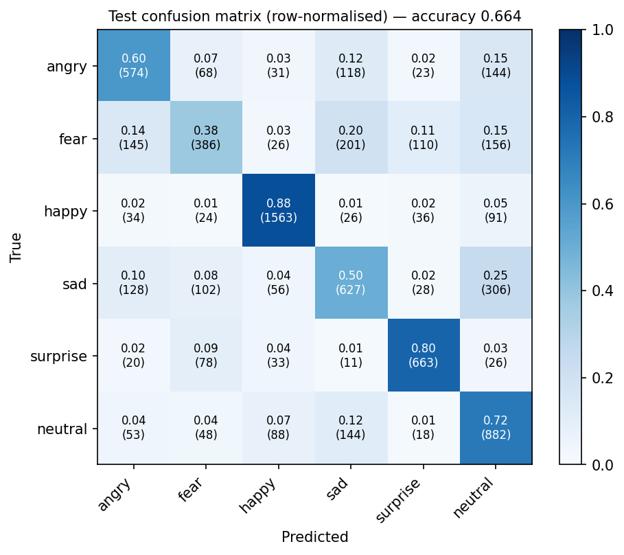
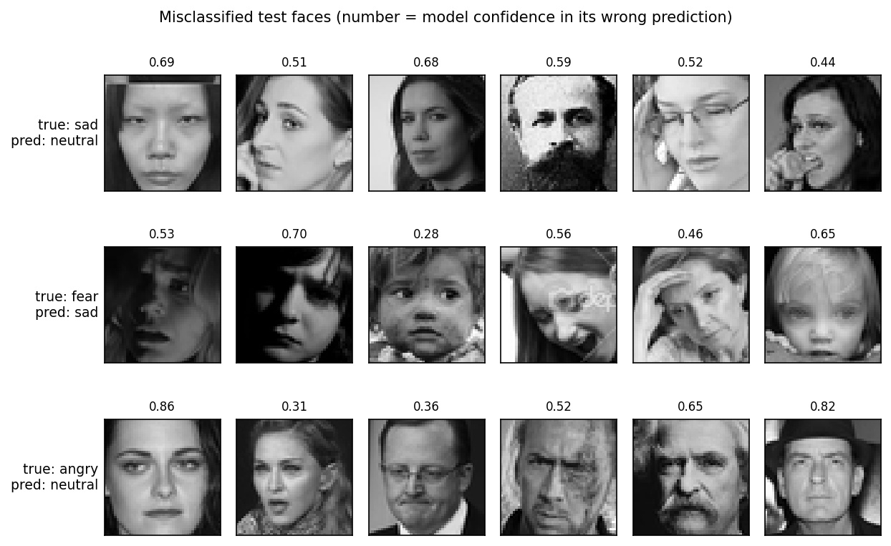
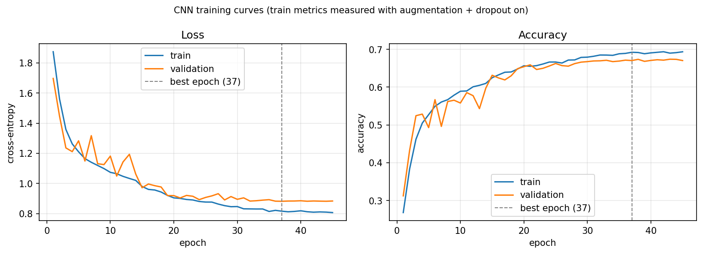

# Facial Emotion Recognition with a CNN (FER-2013)

A convolutional neural network that classifies **6 facial expressions** (angry, fear, happy, sad, surprise, neutral) from 48×48 grayscale face images, trained and evaluated on FER-2013, plus a **real-time webcam demo** using OpenCV.

**Test set: 66.4% accuracy (95% CI ±1.1) · macro-F1 0.641 · 7,067 images · evaluated once**

---

## Results

### Baselines vs CNN (validation set)
| Model | Val accuracy | Val macro-F1 |
|---|---|---|
| Majority class (always "happy") | 0.255 | 0.068 |
| Logistic regression on raw pixels | 0.347 | 0.321 |
| **CNN (4 conv blocks)** | **0.670** | **0.646** |

### CNN per-class performance (test set)
| Class | Precision | Recall | F1 | Test images |
|---|---|---|---|---|
| angry | 0.602 | 0.599 | 0.600 | 958 |
| fear | 0.547 | 0.377 | 0.446 | 1,024 |
| happy | 0.870 | 0.881 | 0.875 | 1,774 |
| sad | 0.556 | 0.503 | 0.528 | 1,247 |
| surprise | 0.755 | 0.798 | 0.776 | 831 |
| neutral | 0.550 | 0.715 | 0.622 | 1,233 |



### What the model gets right and wrong
- **Happy (F1 0.875) and surprise (0.776) are recognised best.** Both have large, distinctive mouth shapes that survive the 48×48 resolution.
- **Fear is hardest (recall 0.377).** Its faces are spread across sad (20%), neutral (15%), angry (14%) and surprise (11%).
- **The biggest single confusion is sad → neutral (24.5% of sad faces).** Subtle sadness differs from a resting face by only a few pixels.
- **Neutral acts as a fallback class:** high recall (0.715) but low precision (0.550), because it absorbs uncertain sad, fear and angry faces.
- In a random sample of misclassified test faces, many errors were ambiguous or arguably mislabelled, some were poor image conditions (shadows, watermarks, occlusion), and some were genuine model mistakes.



### Training


Validation loss reached its minimum at epoch 37. Early stopping ended training at epoch 45 and restored the epoch-37 weights. Training took about 69 minutes on a MacBook Pro M1 (8 GB) CPU.

---

## Approach

**Data.** FER-2013 from the original Kaggle competition (`icml_face_data.csv`): 35,887 grayscale 48×48 face images with the official `Training` / `PublicTest` / `PrivateTest` assignment.

**Dropping "disgust".** Disgust has only 436 training images (1.5% of the data), 16.5× fewer than happy. I removed it, leaving 35,340 images in 6 classes and reducing the training imbalance to 2.3×. *Consequence: results are not directly comparable to 7-class FER-2013 benchmarks.*

**Splits.**
- **Train / validation:** the official `Training` split, divided 90/10 with stratification (seed 42), giving 25,445 / 2,828 images.
- **Test:** `PublicTest` + `PrivateTest`, 7,067 images. Used once, after the model was frozen.

**Preprocessing.** Pixels scaled to 0–1 and reshaped to 48×48×1. The webcam demo applies exactly the same steps.

**Baselines.**
- **Majority class:** always predicts the most common class.
- **Logistic regression:** standardised raw pixels, C = 0.1, 300 iterations (not fully converged).

**CNN (1.77M parameters, Keras).**
- **Augmentation, inside the model and active only during training:** horizontal flip, ±11° rotation, ±10% shift.
- **4 convolutional blocks** with 32 → 64 → 128 → 256 filters. Each block is 2 × [3×3 conv → batch norm → ReLU], then 2×2 max-pooling and dropout 0.25.
- **Head:** dense 256 → batch norm → ReLU → dropout 0.5 → softmax over 6 classes.

**Training.** Adam (learning rate 1e-3), sparse categorical cross-entropy, batch size 64.
- **Early stopping** on validation loss (patience 8, restoring the best weights).
- **ReduceLROnPlateau:** learning rate × 0.5 after 3 epochs without improvement.

**Live demo** (`demo.py`):
1. OpenCV captures webcam frames and a Haar cascade detects faces.
2. The largest face is cropped, converted to grayscale, resized to 48×48 and scaled to 0–1.
3. The CNN predicts, and probabilities are smoothed over frames with an exponential moving average so the label doesn't flicker.
4. The top emotion and its confidence are drawn on the frame.

Runs at about 15 FPS on an M1 CPU.

---

## Project structure
```
├── train.ipynb          # data loading, split, baselines, CNN training, evaluation
├── demo.py              # real-time webcam demo
├── requirements.txt
├── figures/             # plots used in this README
├── models/
│   └── emotion_cnn.keras   # trained model (best epoch)
└── data/                # FER-2013 CSV goes here (not included)
```

## How to run

**1. Set up** (tested with Python 3.9 on macOS, Apple Silicon)
```bash
git clone https://github.com/techydeola/facial-emotion-cnn.git
cd facial-emotion-cnn
python3 -m venv .venv && source .venv/bin/activate
pip install -r requirements.txt
```

**2. Run the webcam demo** (uses the included trained model)
```bash
python demo.py      # press q in the video window to quit
```
On macOS, allow camera access for your terminal app the first time (System Settings → Privacy & Security → Camera), then restart the terminal.

**3. Retrain from scratch (optional)**
1. Download `icml_face_data.csv` from the [Kaggle FER-2013 competition](https://www.kaggle.com/c/challenges-in-representation-learning-facial-expression-recognition-challenge/data). Accept the competition rules first.
2. Put it in `data/`.
3. Open `train.ipynb` and choose **Run All**. Training takes about 70 minutes on an M1 CPU, and is much faster on a GPU such as Google Colab.

> Results may differ slightly between runs and machines, even with fixed seeds.

---

## Limitations and ethics

### Dataset and accuracy
- **Noisy labels and a low ceiling.** FER-2013 was collected by searching Google Images for emotion-related keywords, and its labels are noisy. The dataset's authors estimated **human accuracy at about 65 ± 5%** (Goodfellow et al., 2013). During error analysis, two human viewers also disagreed on several faces. The 66.4% test accuracy should be read as close to this dataset's practical ceiling, not as a measure of real-world reliability.
- **Class imbalance.** Happy makes up 25% of the data and surprise 11%. Disgust (1.5%) was dropped. The model is strongest on large or visually distinctive classes and weakest on fear (recall 0.38).
- **6 classes, not 7.** Because disgust was removed, results are not directly comparable to published 7-class FER-2013 results.
- **Dataset bias (not measured).** FER-2013 has no demographic labels, so I could not test performance across age, gender or skin tone. Web-scraped photos over-represent some groups and exaggerated, posed expressions. Performance may differ across groups in ways this project does not measure.
- **Consent.** The images were scraped from the web, and the people pictured did not consent to their use in machine learning. This repo does not redistribute the dataset. The figures show a small number of dataset images for illustration only.

### Live demo
- Works best with a **frontal face, fully in frame, with even lighting**. The Haar cascade fails on side profiles and partly visible faces. A low camera angle and side lighting reduce accuracy.
- Tracks **only the largest face** in the frame, at about 15 FPS on an M1 CPU.
- In live testing, behaviour matched the test-set results: happy and surprise were recognised reliably, angry with lower confidence, and **sad was usually read as neutral**.

### Facial expressions are not felt emotions
This model classifies facial **expressions**, matched against the labels annotators gave to web photos. It does **not** detect what a person actually feels. Research shows that people do not reliably make one specific facial configuration for each emotion, and the same expression can mean different things depending on context and culture (Barrett et al., 2019). A prediction of "angry" means "this face resembles images labelled angry", nothing more.

### Legal context: EU AI Act
Since **2 February 2025**, Article 5(1)(f) of the EU AI Act (Regulation (EU) 2024/1689) **prohibits placing on the market, putting into service or using AI systems to infer people's emotions in the workplace and in education institutions**, except for medical or safety reasons. The European Commission's guidelines give examples such as tracking employees' emotions in call centres, inferring students' attention, and analysing emotions during recruitment. Outside these settings, emotion recognition systems are classified as **high-risk**.

**This project is a learning exercise.** It is not intended for, and should not be used for, monitoring employees, job candidates or students, or for making any decision about a person. *(This is a summary for context, not legal advice.)*

---

## References
- Goodfellow, I. et al. (2013). *Challenges in Representation Learning: A report on three machine learning contests.* arXiv:1307.0414. (FER-2013 dataset and human-accuracy estimate)
- Barrett, L. F., Adolphs, R., Marsella, S., Martinez, A. M., & Pollak, S. D. (2019). *Emotional Expressions Reconsidered: Challenges to Inferring Emotion From Human Facial Movements.* Psychological Science in the Public Interest, 20(1), 1–68.
- Regulation (EU) 2024/1689 (AI Act), Article 5(1)(f), and the European Commission's *Guidelines on prohibited artificial intelligence practices* (February 2025).